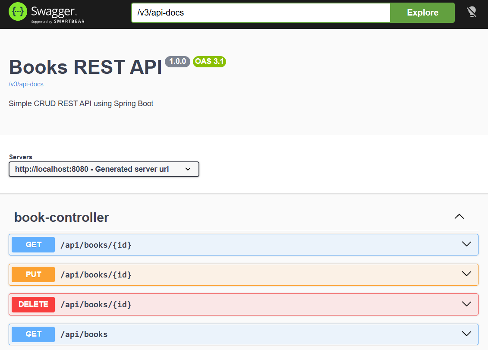

# 📚 Sring Boot 4 Books REST API Basic




A Spring Boot 4 RESTful API project created for learning, practicing, and reviewing REST API fundamentals.

This project focuses on understanding:

* REST API routing
* CRUD operations
* Path Variables
* Query Parameters
* RequestBody handling
* Java Stream filtering
* Basic API structure using Spring Boot

The application uses an `ArrayList` to simulate a database in order to keep the project simple and focused on REST API concepts.

## 🚀 Run Project

Run the application via your IDE or using Maven Wrapper:

```bash id="x92bhm"
./mvnw spring-boot:run
```

Swagger UI:

```txt id="7u98af"
http://localhost:8080/swagger
```

## 🔗 API Endpoints

| Method | Endpoint          | Description          |
| ------ | ----------------- | -------------------- |
| GET    | `/api/books`      | Get all books        |
| GET    | `/api/books/{id}` | Get book by ID       |
| POST   | `/api/books`      | Create new book      |
| PUT    | `/api/books/{id}` | Update existing book |
| DELETE | `/api/books/{id}` | Delete book          |

## 🔍 Query Parameters

Supports optional filtering for:

| Query Parameter | Description             |
| --------------- | ----------------------- |
| category        | Filter by category      |
| author          | Filter by author name   |
| title           | Filter by title keyword |

Example request:

```http id="mv0i4o"
GET /api/books?category=music&author=nattapong
```

Example Request Body:

```json id="trb6s1"
{
  "id": 7,
  "title": "WordPress Security Guide",
  "author": "WPBeginner",
  "category": "Web Development"
}
```

